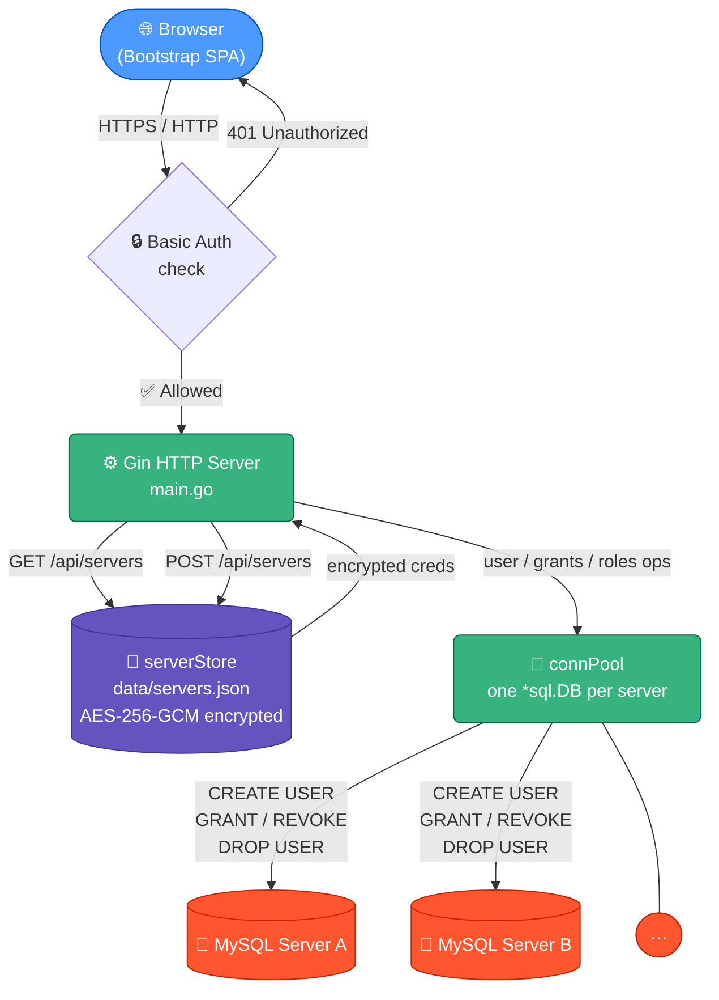

# go-admin-mysql

A lightweight, self-hosted web UI for managing MySQL users, roles, and permissions across multiple servers.

Built in Go with a single-page Bootstrap frontend — ships as a single binary with no external runtime dependencies.

---

## Features

- **Multi-server management** — register as many MySQL servers as you need; connection credentials are stored encrypted (AES-256-GCM) on disk
- **User management** — create and delete MySQL users
- **Role management** — create, delete, assign, and revoke MySQL roles (MySQL 8.0+)
- **Permission management** — grant and revoke privileges at the global, database, or table level; view raw `SHOW GRANTS` output
- **Connection testing** — verify connectivity to any registered server on demand
- **Protected UI** — all routes are secured behind HTTP Basic Auth

---

## Quickstart (local)

### Prerequisites

- [Go 1.21+](https://go.dev/dl/)
- Network access to one or more MySQL servers
- `openssl` (used to generate credentials)

### 1. Clone and build

```bash
git clone https://github.com/masseo1/go-admin-mysql.git
cd go-admin-mysql
make build
```

### 2. Generate and save your credentials

Run this block — it generates both values **and prints them** so you can save them:

```bash
export ADMIN_PASS=$(openssl rand -base64 24)
export ENCRYPTION_KEY=$(openssl rand -hex 32)

echo ""
echo "=== SAVE THESE NOW — you will need them every time you run the tool ==="
echo ""
echo "ADMIN_PASS:     $ADMIN_PASS"
echo "ENCRYPTION_KEY: $ENCRYPTION_KEY"
echo ""
echo "======================================================================="
```

You will see output like:

```
=== SAVE THESE NOW — you will need them every time you run the tool ===

ADMIN_PASS:     <randomly generated value>
ENCRYPTION_KEY: <randomly generated value>

=======================================================================
```

**Save both values now** before doing anything else. These are personal credentials for running the tool on your own machine — store them somewhere only you can access:

| Option | Notes |
|---|---|
| Personal vault in your password manager (1Password, Bitwarden, etc.) | Best option if you have a personal vault separate from shared team vaults |
| macOS Keychain / GNOME Keyring | Built into your OS, no extra software needed |
| A local `.env` file in the repo directory | Quick option — the file is already in `.gitignore` so it will never be committed |

| Field | What to save |
|---|---|
| `ADMIN_PASS` | The web UI login password. If you forget it, just re-generate a new one and restart the tool — no data is lost. |
| `ENCRYPTION_KEY` | The encryption key for stored MySQL passwords. **This one is critical** — if you lose it, all the MySQL server credentials saved in the tool are unrecoverable and you will need to re-enter them. |

> Do **not** re-generate `ENCRYPTION_KEY` once you have added servers — you will lose access to those saved credentials.

**Optional: save to a local `.env` file for convenience**

```bash
cat > .env <<EOF
export ADMIN_PASS="$ADMIN_PASS"
export ENCRYPTION_KEY="$ENCRYPTION_KEY"
EOF
chmod 600 .env
```

Then load it any time before running:

```bash
source .env && make run
```

### 3. Run

```bash
make run
```

The tool uses the `ADMIN_PASS` and `ENCRYPTION_KEY` values exported in your current terminal session. If you open a new terminal, re-export them before running:

```bash
# Either source your .env file:
source .env && make run

# Or paste the values directly:
export ADMIN_PASS="<your-saved-admin-pass>"
export ENCRYPTION_KEY="<your-saved-encryption-key>"
make run
```

### 4. Open the UI

Navigate to [http://localhost:8080](http://localhost:8080) and log in:

- **Username:** `admin`
- **Password:** the `ADMIN_PASS` value you saved in step 2

---

## Environment variables

| Variable | Required | Default | Description |
|---|---|---|---|
| `ENCRYPTION_KEY` | **yes** | — | 32+ character string used as the AES-256 key for encrypting stored MySQL passwords |
| `ADMIN_PASS` | **yes** | — | Password for the web UI login |
| `ADMIN_USER` | no | `admin` | Username for the web UI login |
| `DATA_DIR` | no | `/data` | Directory where `servers.json` is persisted |
| `PORT` | no | `8080` | TCP port to listen on |

---

## MySQL user requirements

The MySQL user you register with each server needs at minimum:

```sql
-- Read-only view of users and grants
GRANT SELECT ON mysql.user TO 'admin_user'@'%';

-- Create/drop users and flush privileges
GRANT CREATE USER, RELOAD ON *.* TO 'admin_user'@'%' WITH GRANT OPTION;
```

For full management (granting and revoking arbitrary privileges):

```sql
GRANT ALL PRIVILEGES ON *.* TO 'admin_user'@'%' WITH GRANT OPTION;
```

> **Principle of least privilege:** Grant only what your team needs. If you only need to read and manage user access, the first block is sufficient.

---

## How it works



---

## Using the UI

### Adding a server

1. Click **Add Server** in the left sidebar
2. Enter the display name, host, port (default `3306`), MySQL username, and password
3. Enable **TLS** if your MySQL server requires encrypted connections
4. Click **Add Server** — it appears in the sidebar immediately
5. Click **Test** to verify connectivity

### Managing users (Users tab)

| Action | How |
|---|---|
| Create user | Fill in username, host (`%` for any host), password |
| Delete user | Click the trash icon — uses `DROP USER IF EXISTS` |
| View permissions | Click the key icon to jump to the Permissions tab for that user |

### Managing roles (Roles tab — MySQL 8.0+ only)

| Action | How |
|---|---|
| Create role | Enter a role name, click **Create Role** |
| Delete role | Click the trash icon |
| Assign role | Choose user and role from dropdowns, click **Assign** |
| Revoke role | Same, click **Revoke** |

### Managing permissions (Permissions tab)

1. Select a user — current grants appear in the dark panel
2. **Grant**: choose privilege, database (`*` for global), optional table, click **Grant**
3. **Revoke**: same inputs, click **Revoke**

Supported privileges are validated against a server-side allowlist — unrecognised values are silently replaced with `USAGE` (no-op).

---

## Docker

```bash
docker build -t go-admin-mysql:latest .

docker run -d \
  -p 8080:8080 \
  -e ENCRYPTION_KEY="$(openssl rand -hex 32)" \
  -e ADMIN_PASS="$(openssl rand -base64 24)" \
  -v /path/to/data:/data \
  go-admin-mysql:latest
```

The container runs as UID 1001 with a read-only root filesystem. Only `/data` needs to be writable.

---

## Kubernetes deployment

Full instructions are in [`k8s/README.md`](k8s/README.md).

---

## Architecture

```
Browser (Bootstrap SPA)
        │  HTTP Basic Auth
        ▼
  Gin HTTP server  (main.go)
        │
  ┌─────┴────────────────────────────┐
  │  serverStore  (data/servers.json)│  ← AES-256-GCM encrypted passwords
  │  connPool     (*sql.DB × N)      │  ← one pool per registered server
  └──────────────────────────────────┘
        │  go-sql-driver/mysql
        ▼
  MySQL servers  (one or many)
```

| Path | Purpose |
|---|---|
| `main.go` | Entire backend: encryption, store, connection pool, all HTTP handlers |
| `static/index.html` | Single-file SPA embedded into the binary at build time |
| `Dockerfile` | Multi-stage build; runs as UID 1001, read-only root filesystem |
| `k8s/` | Kubernetes manifests |
| `Makefile` | Common tasks: build, run, docker, k8s |

---

## Security

- **Passwords at rest** — MySQL server passwords are encrypted with AES-256-GCM; plain text never touches disk.
- **No passwords over the wire** — the API response type omits the password field entirely.
- **SQL injection prevention** — all user input is escaped or validated against an allowlist before being used in SQL.
- **Network exposure** — this tool has broad MySQL access. **Do not expose it to the public internet.** Run it locally or behind a VPN.
- **TLS** — always deploy behind HTTPS in shared or production environments.

---

## REST API

All endpoints require HTTP Basic Auth. Full reference in [`docs/api.md`](docs/api.md).

---

## Contributing

See [CONTRIBUTING.md](CONTRIBUTING.md).

## Changelog

See [CHANGELOG.md](CHANGELOG.md).
